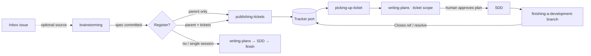

# Tracker Bridge — Design

## Problem

Work in this library is session-bound. A spec and a plan are committed files,
and SDD's ledger lets one plan resume, but nothing answers "what can be worked
on next" across features, nothing lets a fresh session claim a slice of work
without a human re-explaining it, and ideas or bugs that are not yet specs have
nowhere to land. The workaround is `handoff`: a per-session reasoning dump that
carries intent from one context window to the next. It works, but every
multi-session feature pays a handoff per session and the queue lives in the
user's head.

Matt Pocock's skills solve this with an issue tracker: `to-spec` publishes the
spec as an issue, `to-tickets` cuts it into tracer-bullet tickets with blocking
edges, `implement` works one ticket per fresh session. His docs also record the
rough edges: large spec issues truncate with no local copy to fall back on,
`implement` never closes the ticket so the frontier never visibly advances, and
label state machines drift because agents forget to move labels.

This design brings the tracker into the fork as a thin bridge, keeping the
spine (brainstorming → writing-plans → SDD → finishing) and the fork's
invariants: repo files are the source of truth, nothing is required in a clean
repo, the human stays in the loop at every gate.

## Scope of the change

1. A **tracker port**: seven operations behind a config file and a script, with
   a GitHub adapter and a local-markdown adapter.
2. Three new skills: `setting-up-tracker` (user-invoked wizard),
   `publishing-tickets` (spec → parent issue, optionally → tickets),
   `picking-up-ticket` (a runner: ticket → claim → worktree → plan → SDD →
   finish → resolve).
3. Seam edits to `brainstorming`, `writing-plans`,
   `finishing-a-development-branch`, `handoff`, `using-superpowers`, plus
   README, plugin manifest, three `commands/*.md`.
4. Glossary terms in `CONTEXT.md` and ADR 0002.

Single-session work is unchanged apart from one closing offer in brainstorming
that only appears when a tracker is configured.

## Decisions settled in the interview

| Decision | Choice | Why |
|---|---|---|
| Scope | Tracker only. AFK runner, marker and no-human escalation deferred. | The user's values are HITL and smart-model coherence; AFK moves the human to the end. Ticket contract is identical for human and unattended pickup, so deferral costs nothing. |
| Integration shape | Thin bridge in the fork, not a port of Pocock's skills and not side-by-side plugins. | Side-by-side duplicates five skills and his `implement` is blind to SDD; a full port maximizes upstream-sync conflicts. |
| Tracker config | `docs/agents/issue-tracker.md`, Pocock's path and headings, written by a setup skill. Hard precondition only for publishing and pickup. | Interop with his skills during the trial; preserves read-if-present for everything else. |
| Where the spec lives | Repo file is the source of truth; a parent issue links path + commit. | Agents in a checkout read files; his docs log truncation on spec issues. |
| Unit of work | Two-level: spec → **tickets** (durable, behavioral, tracker) → at pickup a **plan** (tasks with paths and code) for that one ticket. | Tickets sit for weeks so paths would go stale; the plan is the HITL review surface and is written when paths are fresh. |
| Ticket state | GitHub native: open + no open blockers + no assignee = frontier; assignee = claimed; linked PR = in review; closed = done. Labels only for kind. | Fewest labels, one query, nothing to keep in sync. Pocock's most-filed gap is missing states in his label machine. |
| Port shape | Scripts for GitHub and local; prose config as the backend switch and the escape hatch for other trackers. | His docs record agents hallucinating `gh` flags; SDD already ships scripts for mechanical steps. |
| Per-ticket plan location | `docs/superpowers/plans/`, committed on the ticket branch. | Lands and is reviewed with the PR; SDD resumes from a plan path. |
| Brainstorming terminal | One offer after spec commit: parent only / parent + tickets / no. | Spine auto-routes; putting work on the tracker is the human's call. |
| Pickup invocation | Model-invokable, entered only via an explicit ticket reference; no skill may invoke it. `setting-up-tracker` is user-invoked. | Brainstorming's offer and "work on #12" must be able to reach publishing and pickup. |
| Dev version | Branch `next`, iterated with `--plugin-dir`; later a `stateful-superpowers-next` marketplace entry pinned to `ref: next`, enabled per test project; promote by merging to `main` as 0.9.0. | Verified against the plugin docs: same-name `--plugin-dir` shadows the installed plugin; project `enabledPlugins` overrides user. |
| Validation | Dogfood: build this feature through the two-level model by hand first. | Cheap evidence before touching tuned donor skills. |
| Wayfinder | Not now. Port designed so it is a thin skill later on the same substrate. | It is the design-side twin (decision tickets), reuses our grilling and prototype, and would double this spec. |

## Artifact model

The line: **the tracker holds graph and state, never content.**

| Artifact | Role | Lifetime | Owner |
|---|---|---|---|
| `CONTEXT.md`, `docs/adr/` | durable meaning: language, hard-to-reverse decisions | forever | grilling, designing-modules |
| Spec, PRD | durable intent for one feature: what and why, the review contract | forever, committed | brainstorming |
| **Ticket** | schedulable unit of intent: a vertical slice of the spec, behavioral, self-contained, with edges and state | until closed | publishing creates; pickup and finishing mutate state |
| Plan | ephemeral procedure for one ticket: tasks with paths and code | lands with the PR | writing-plans, at pickup |
| SDD ledger | in-flight execution state for one plan | deleted at end | SDD |
| PR | review surface and merge gate; closes the ticket | forever | finishing-a-development-branch |
| Handoff | reasoning in transit when something non-artifact must travel | one hop | handoff |

What the tracker uniquely adds: the **frontier** across features, **claim**,
an **inbox** for ideas and bugs that are not specs yet, and the lineage of one
issue from idea to spec to tickets to done. Every spec gets a parent issue when
a tracker is configured (so the index is complete); tickets exist only when the
work spans sessions.

## Architecture

| Module | Interface (what a caller must know) | Seam | Depth rationale | Test surface |
|---|---|---|---|---|
| **Tracker port** | Seven operations (below). Invariants: parents and children carry a `kind` label; edges are native dependencies; blockers are published before dependents; `frontier` filters by kind. Error modes: no config → "run setting-up-tracker"; label missing → create it; `gh` missing or unauthenticated → fail loudly. | `docs/agents/issue-tracker.md` names the backend; `scripts/tracker <op>` executes it | Deep: hides `gh` flags, the dependency API, sub-issue wiring, label creation, local-file conventions. Deletion test: four callers re-derive `gh` incantations and drift. | Shell tests in `tests/tracker/` against the local adapter always and a scratch GitHub repo when authenticated |
| ↳ GitHub adapter | `gh` ≥ 2.94, issues enabled | behind the port | true external | scratch repo |
| ↳ Local adapter | `docs/superpowers/tickets/<parent-slug>/`, committed; `Status:` line is the state | behind the port | local-substitutable; doubles as the test stand-in | filesystem |
| **setting-up-tracker** (user-invoked) | Run once per repo, idempotent. Detects remote, proposes backend, writes config, enables issues if off, creates kind labels, adds a pointer block to CLAUDE.md. Hard precondition only for publishing and pickup. | new skill + `/setup-tracker` | Shallow by design: a wizard. | Fresh repo → config present, labels exist, re-run is a no-op |
| **publishing-tickets** | Input: committed spec path, optional existing issue ref, mode `register` or `slice`. Output: parent ref and ticket refs. Terminal: stops. | new skill + `/publish-tickets`; called from brainstorming's closing offer | Deep: hides slicing rules, edge-wiring order, body template, parent reuse. Register-only as a separate skill fails the deletion test. | Three-module spec → vertical tickets, blockers first, no paths in bodies |
| **picking-up-ticket** (runner) | Input: ticket ref, or none → frontier → user picks. Fixed sequence with one artifact per step; Step 0 resumes at the first missing artifact. Ordering invariants: claim before any write, plan before any code, never on `main`. No skill may invoke it. | new skill + `/pick-up-ticket`; terminal is finishing-a-development-branch | Deep: one ticket in, one PR or merge out. Adds no judgment of its own. | Linearity pressure tests (below) |
| **brainstorming** (seam) | Accepts an issue ref as the idea source. After spec commit, if config exists, one offer. | step 1, closing offer | unchanged | Offer appears once; declining leaves the flow identical to today |
| **writing-plans** (seam) | Optional `**Ticket:**` header field; plan scoped to that ticket's acceptance criteria; scope check hardened. | plan header | unchanged | Plan for a ticket touches only that ticket |
| **finishing-a-development-branch** (seam) | Branch `ticket/<ref>-<slug>` is the signal. PR body gets `Closes <ref>`; local merge calls `resolve`; keep-as-is stays claimed. | step 5 | unchanged | Local merge → ticket closed; PR path → body carries the close keyword |
| **handoff** (seam) | Description narrowed. | description | unchanged | Trigger eval |
| **using-superpowers** (seam) | Routing lines for ticket work and "what's next". | routing table | | Trigger eval |



**Taxonomy.** Pickup is a **runner skill** (fixed sequence, verifiable
checkpoints, no interview), the same kind as `executing-plans` and SDD. It is
not a front-end, so ADR 0001's "which engines does a new front-end reuse"
question does not fire.

**Frontier view.** A separate "what's next" skill would be a pass-through over
`frontier`; it is pickup's no-argument mode.

## Component specification

### Tracker port

**Config.** `docs/agents/issue-tracker.md`. The backend is read from the H1,
which Pocock's templates and ours share: `# Issue tracker: GitHub` or
`# Issue tracker: Local Markdown`. Our templates carry his sections plus a
`## Ticket operations` section documenting the seven operations for the human
and for "other" trackers. Any other H1 means "other": the scripts refuse and
the skills follow the prose.

**Scripts.** `skills/picking-up-ticket/scripts/tracker <op> [args]`, bash,
same style as SDD's `scripts/`. Other skills reference it by relative path, as
SDD references `../requesting-code-review/code-reviewer.md`. Each op prints a
machine-readable result on stdout and exits non-zero with a one-line reason on
failure.

**Kinds.** Parent kinds: `spec` now, `map` reserved. Child kinds: `ticket`
now, `decision` reserved. On GitHub a kind is a label of the same name; setup
creates `spec` and `ticket`.

| Op | Args → result | GitHub | Local |
|---|---|---|---|
| `register-parent` | `kind title spec-path sha [summary-file]` → ref | issue with kind label; body = path @ sha + summary | `docs/superpowers/tickets/<slug>/00-<kind>.md` |
| `publish-ticket` | `parent kind title body-file [blocked-by refs]` → ref | issue with kind label, sub-issue of parent, native blocked-by edges | `NN-<slug>.md` with `Parent:` and `Blocked by:` lines, `Status: ready` |
| `frontier` | `kind [parent]` → refs | open, kind label, `issue_dependencies_summary.blocked_by == 0`, no assignee, optionally scoped to the parent's sub-issues | `Status: ready` and every blocker `Status: done` |
| `fetch` | `ref` → body, state, blockers, parent, assignee | `gh issue view --json` + dependencies | file |
| `claim` | `ref` → ok | assign `@me`; idempotent if already mine; refuse if assigned to another | `Status: claimed`, commit |
| `resolve` | `ref what` → ok | close with comment "Resolved by <what>" | `Status: done`, commit |
| `comment` | `ref text-file` → ok | issue comment | append under `## Comments` |

Blockers are published before dependents so edges can be wired at creation.
Publishing never modifies or closes the parent.

**Ticket body template** (both adapters, GitHub without the header lines):

```markdown
# <NN>: <Ticket title>

Parent: <parent ref>
Blocked by: <refs> | None (can start immediately)
Status: ready

## What to build

The end-to-end behaviour this ticket makes work, from the user's perspective.

## Acceptance criteria

- [ ] Criterion that is false at the base commit and true when done
- [ ] ...

## Spec

`docs/superpowers/specs/<file>.md` @ <sha>, section "<heading>"
```

No file paths and no code in ticket bodies. The one exception, inherited from
Pocock: a snippet a prototype produced that encodes a decision more precisely
than prose (state machine, schema, type shape).

**Parent body:** title, spec path @ sha, a one-paragraph summary from the
spec's problem statement. On GitHub the sub-issue list is native; locally
`00-spec.md` lists the child files.

### setting-up-tracker

User-invoked (`disable-model-invocation: true`), `/setup-tracker`. Prompt-driven,
not a deterministic script, like Pocock's setup.

1. Explore: `git remote -v`; existing `docs/agents/issue-tracker.md`;
   `CLAUDE.md` / `AGENTS.md`; existing `docs/superpowers/tickets/`.
2. Propose: GitHub if a remote points at github.com, else local markdown. One
   confirmation. "Other" records the user's one-paragraph description under the
   `other` H1.
3. Write the config from the template in the skill folder. On GitHub: enable
   issues if disabled (ask first; `gh repo edit --enable-issues`), create the
   `spec` and `ticket` labels if missing.
4. Add or update a `## Agent skills` block in whichever of `CLAUDE.md` /
   `AGENTS.md` exists, three lines pointing at the config. Never create the
   other file.
5. Report which skills now read the config. Re-running changes nothing unless
   the backend changes.

### publishing-tickets

Model-invokable, `/publish-tickets <spec-path> [issue-ref]`. Entered from
brainstorming's closing offer or by the user.

Preconditions: config present (else "run /setup-tracker"); spec file committed
(else refuse: the ticket pointer needs a sha).

1. **Parent.** If an issue ref was given, reuse it: relabel to `spec`, rewrite
   its body with the parent template, keep its history. Otherwise
   `register-parent spec`.
2. **Mode.** `register` stops here. `slice` continues. The mode comes from the
   caller (brainstorming's offer) or the user; when unspecified, ask once.
3. **Draft slices.** Read the whole spec, including its Architecture section.
   Each ticket is a tracer bullet: a narrow but complete path through every
   layer the spec names, demoable or verifiable on its own, sized to one fresh
   context window. Slice *through* the Architecture modules, never one ticket
   per module. Prefactoring first. Wide refactors are sequenced
   expand → migrate batches → contract, as in Pocock's `to-tickets`.
4. **Quiz.** Present a numbered list: title, blocked by, what it delivers, demo
   path. Ask whether granularity, edges, merges or splits are right. Iterate
   until approved. Nothing reaches the tracker before approval.
5. **Publish** blockers-first via `publish-ticket`, each body from the template
   with the spec pointer at the committed sha and the section heading the slice
   implements. Report parent and ticket refs by title, then stop.

### picking-up-ticket

Model-invokable, `/pick-up-ticket [ref]`. A runner. Never invoked by another
skill. Announces "I'm using the picking-up-ticket skill for <ticket title>."

Workspace: `.superpowers/pickup/<ref>/` (git-ignored, like `.superpowers/sdd/`).

**Step 0: detect.** Check each artifact in order and resume at the first
missing one. After compaction or in a new session this is what prevents
re-claiming or re-planning.

| Step | Artifact | Action when missing |
|---|---|---|
| 1 fetch | `<workspace>/ticket.md` | no ref → `frontier ticket`, show titles, user picks; then `fetch`, write the file |
| 2 claim | assignee is me | refuse if open blockers or another assignee, naming them; else `claim` |
| 3 worktree | worktree on branch `ticket/<ref>-<slug>` | `superpowers:using-git-worktrees` |
| 4 plan | plan file whose header has `**Ticket:** <ref>` | `superpowers:writing-plans` with the ticket scope: inputs are the spec path @ sha and the ticket body |
| 5 approve | the user has chosen an execution mode | writing-plans' existing execution-choice prompt; the human reads the plan here |
| 6 execute | SDD ledger for this plan | `superpowers:subagent-driven-development` (or executing-plans if chosen) |
| 7 finish | PR whose body carries `Closes <ref>`, or ticket closed | `superpowers:finishing-a-development-branch` |

Two conditionals only: ref given or not; finishing's existing menu. No model
selection, no review logic, no slicing: those stay in SDD and publishing.

Rationalization table (at most six rows), including: "it's small, just TDD it"
→ the plan file exists before any code; "I'll re-plan to be safe" → Step 0
found a plan, use it; "the ticket is mine already so I'll skip the claim check"
→ Step 0 checks the assignee, not your memory; "worktrees are overhead for one
ticket" → never write on `main`.

### Seam edits

**brainstorming.**
- Step 1 (explore context): if the idea arrives as an issue ref and a tracker
  is configured, `fetch` it and treat body + comments as the idea.
- After step 7 (design doc committed), when `docs/agents/issue-tracker.md`
  exists, one offer, its own message:
  > "Register this spec on the tracker? **Parent issue only** keeps it indexed;
  > **parent + tickets** also slices it for pickup in fresh sessions; **no**
  > continues to the plan as usual. Tickets are worth it when the build spans
  > more than one context-window-sized slice."
  Parent only → invoke publishing in `register` mode, then continue to
  writing-plans. Parent + tickets → invoke publishing in `slice` mode and stop;
  the terminal for this spec is pickup per ticket. No → writing-plans.
- No config → no offer, flow identical to 0.8.0.
- Scope check note for later: "too big and foggy" is wayfinder's exit once it
  exists; today it still decomposes into a PRD.

**writing-plans.**
- Header gains an optional line after Goal: `**Ticket:** <ref>` with the spec
  pointer. When present, the plan covers only that ticket's acceptance criteria
  and the Interfaces blocks name what sibling tickets will rely on.
- Scope check: "If one plan would not fit a single context window to execute,
  stop and publish tickets instead (superpowers:publishing-tickets)."
- Filename for a ticket plan: `YYYY-MM-DD-<ref>-<slug>.md`.

**finishing-a-development-branch.**
- Step 2 also records `TICKET=$(git branch --show-current | sed -n
  's#^ticket/\([^-]*\)-.*#\1#p')`.
- Option 1 (merge locally), after the merged result is green: `tracker resolve
  $TICKET <merge-commit>`.
- Option 2 (PR): PR body includes `Closes <ref>` on GitHub, which closes the
  ticket on merge. On the local adapter the ticket stays claimed and gets the PR
  URL via `tracker comment`; `resolve` runs when the merge is pulled, by hand or
  through Option 1's path.
- Option 3: report "Ticket <ref> stays claimed."
- Rationalization row: "the PR will close it anyway" → only if the body says
  `Closes`; check it.

**handoff.** Description becomes: use when moving to a new harness, a new
directory, a colleague, forking a side task mid-phase, or carrying reasoning
not yet captured in a spec, plan or ticket. Body adds one line: with a tracker
configured, finished thinking belongs in the spec and tickets; handoff carries
only what those cannot.

**using-superpowers.** Routing table gains: "Work on a ticket (#N, a ticket
URL, 'what's next on the tracker')" → `superpowers:picking-up-ticket`. Note that
no skill chains into it.

**README.** Skills list gains the three skills under Collaboration and a short
"Working from a tracker" paragraph in The Basic Workflow.

**Manifest and commands.** `commands/setup-tracker.md`,
`commands/publish-tickets.md`, `commands/pick-up-ticket.md`, each the two-line
shape of `commands/sync-context.md`. Version on `next`: `0.9.0-dev`.

**CONTEXT.md.** Terms added in this commit: Runner skill, Issue tracker, Issue,
Ticket, Task, Frontier, Spec issue, Tracker port, Claim. "Decision ticket" is
introduced with wayfinder, not now.

**ADR 0002.** The tracker holds graph and state, never content.

## Data flow

Single-session: unchanged. Multi-session, GitHub backend:

1. Brainstorming commits the spec at sha S and offers registration. User picks
   parent + tickets.
2. Publishing creates issue #10 (`spec`, body: path @ S), then #11, #12, #13
   (`ticket`, sub-issues of #10; #12 and #13 blocked by #11), bodies pointing at
   path @ S and their section. Stops.
3. Fresh session: "pick up #11". Pickup fetches, claims (assignee), creates
   worktree `ticket/11-<slug>`, writing-plans writes
   `docs/superpowers/plans/2026-10-05-11-<slug>.md` with `**Ticket:** #11`,
   user reads it and chooses SDD, SDD runs, finishing opens a PR with
   `Closes #11`.
4. PR merges; GitHub closes #11; #12 and #13 are now on the frontier.
5. Another session: "what's next?" → pickup lists #12 and #13.

## Error handling

| Condition | Behaviour |
|---|---|
| No `docs/agents/issue-tracker.md` | publishing and pickup stop: "run /setup-tracker"; brainstorming skips the offer |
| Config H1 is "other" | scripts refuse; skills follow the prose; pickup still works if the human performs claim/resolve by hand and says so |
| `gh` missing or unauthenticated | script exits non-zero with the reason; skill reports and stops |
| Issues disabled on the repo | setup offers to enable; publishing refuses with the hint |
| Kind label missing | script creates it |
| Spec not committed | publishing refuses |
| Ticket assigned to someone else | pickup refuses, names the assignee |
| Ticket has open blockers | pickup refuses, lists them by title |
| Plan header names a different ticket | pickup stops and reports |
| Worktree for the ticket branch exists | reused (Step 0) |
| Local adapter: concurrent claim | commit conflict surfaces it; resolve by hand |

## Testing

- **Scripts:** `tests/tracker/*.sh` in the style of
  `tests/hooks/test-session-start.sh`. Local adapter exercised on every op in a
  temp repo. GitHub adapter exercised against a scratch repo when `gh auth
  status` succeeds, skipped otherwise.
- **Skills:** pressure tests per `superpowers:writing-skills`, RED on 0.8.0,
  GREEN on `next`, transcripts kept under `docs/superpowers/specs/` as for
  designing-modules:
  1. Ticket given, agent tempted with "it's small, just TDD it" → plan file
     exists before any code.
  2. Session compacted mid-SDD, pickup re-entered → resumes at step 6, no
     re-claim, no re-plan.
  3. Pickup on `main` with no worktree → refuses to write.
  4. Finishing local-merge path → ticket closed; PR path → body carries
     `Closes`.
  5. Brainstorming on a one-plan spec with a tracker configured → offer once;
     declining leaves the transcript identical to 0.8.0 from that point.
  6. Publishing on a three-module spec → tickets are vertical, blockers precede
     dependents, bodies contain no paths.
- **Clean-repo equivalence:** with no config present, every existing eval
  passes unchanged.
- **Trigger evals:** "work on #12" routes to pickup; "pause this, I'll continue
  tomorrow" with tickets present does not route to handoff.

## Rollout and the trial

1. Branch `next` off `main` (this commit). Iterate with
   `claude --plugin-dir /Users/oli/code/super-claude/superpowers`, which
   shadows the installed 0.8.0 for that session under the same namespace.
2. **Dogfood trial, which is also the build.** Enable issues on
   `owittek/stateful-superpowers`. In one session with Pocock's plugin installed,
   run his setup (GitHub backend; its config is the one our port reads) and his
   `/to-tickets` on this spec. His tickets carry `ready-for-agent`, not
   `ticket`; add the `ticket` label by hand so the finished port's `frontier`
   sees them. Then pick each ticket up by hand in a fresh session: claim,
   worktree, writing-plans scoped to the ticket, SDD, finishing.
   This replaces brainstorming's usual writing-plans terminal for this one
   feature. After two or three tickets, decide: continue, or collapse the rest
   into one plan. Record the verdict in this spec's eval notes.
3. Once stable: add a `stateful-superpowers-next` entry to
   `.claude-plugin/marketplace.json` on `main` with `ref: next`; enable it per
   test project with the stable plugin disabled there.
4. Promote: merge `next` to `main`, version 0.9.0, retire the `-next` entry,
   update `docs/upstream-sync.md` provenance (publishing ← `to-tickets`,
   setting-up-tracker ← `setup-matt-pocock-skills`, pickup ← `implement`).

## Deferred, with the seams kept open

- **AFK:** a per-ticket `afk` kind or label, a runner recipe, and a no-human
  escalation path in SDD (PR with open findings, never auto-merge). Nothing in
  the ticket contract changes for it.
- **Wayfinder:** a second producer/consumer on the same port. Parent kind
  `map`, child kind `decision`, map body sections (Destination, Notes, Decisions
  so far, Not yet specified, Out of scope), a decision-resolving runner that
  calls grilling and prototype, and brainstorming's third scope-check exit. It
  replaces handoff for long design work and the PRD for foggy initiatives.
- **Parallel whole-spec orchestration** (`implement-spec`): multiple pickups in
  worktrees onto an integration branch.
- **Triage, research, retro, GitLab adapter, spec-as-issue content.**
