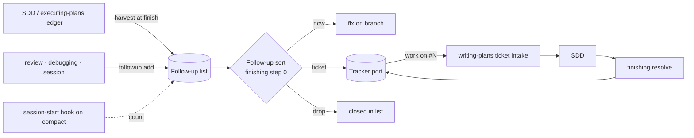

# Intake and the slimmed tracker bridge — Design

PRD: `docs/superpowers/prds/2026-11-16-intake.md` (features 2 and 3; feature 1,
the refresh of `next`, is done). Supersedes the Architecture and Component
specification of `docs/superpowers/specs/2026-10-04-tracker-bridge-design.md`
for `setting-up-tracker` and `picking-up-ticket`; that spec's tracker port,
ticket template, finishing seam and testing approach still hold unless changed
here. `publishing-tickets` is out of this design (PRD feature 4).

## Intent

During feature work the agent and the human keep finding things outside the
current step: drift from a convention, a small bug nearby, an improvement not
backported, a review minor, handoff leftovers. Today they are chased (derailing
the feature) or held in the human's head, agent memory, or a final chat message
that scrolls away. SDD's ledger already records deferred minors and parked
findings, then copies them into its final message and deletes the workspace.

Most of these things are small or tied to the current work and should simply be
done before the branch finishes. Only a few deserve to outlive the session as a
ticket. So: **note at discovery, decide late.** Every follow-up goes on one
durable list for the repo, tagged with its branch; at finishing, the human sorts what's left
into do now, ticket, or drop.

The tracker bridge on `next` was adapted from Matt Pocock's standalone skills
(setup wizard, `to-tickets`, `implement`). Inside the superpowers spine most of
that is glue that existing skills already provide, so this design folds it in.

## Goals

- A follow-up found mid-task is noted in one call without leaving the task, and
  survives compaction, subagent hand-backs and the end of an SDD run.
- No follow-up silently disappears: finishing shows every open one before the
  integration menu.
- Only follow-ups the human chooses to defer become tickets, with no duplicate
  of an open one.
- A ticket is worked through the existing spine: writing-plans → SDD or
  executing-plans → finishing.

## Non-goals

- Pocock-style triage (reporters, `needs-info`, label state machine).
- `publishing-tickets` / spec slicing (PRD feature 4), wayfinder, AFK,
  parallel whole-spec orchestration.
- Committing the follow-up list or syncing it across machines.

## Anti-goals

- Ticket spam: every small thing becoming an issue.
- A mid-task gate that asks the human "ticket-worthy?" on each discovery.
- New per-skill files or folders beyond the one follow-up list (the pickup
  workspace is removed in exchange).
- Changing upstream's SDD ledger protocol or brainstorming beyond named
  insertion points.

## Constraints

- Clean repo (no tracker config, no follow-ups) behaves exactly as 0.9.0.
- `hooks/session-start` starts no processes (Windows/Git Bash cost, broken PATH
  at startup); additions use shell builtins only.
- Scripts follow the SDD helper style: bash, `-C DIR`, one-line reason on
  stderr, exit 2 for usage errors, called by absolute path
  (`tests/sdd-helper-paths`), shellcheck-clean (`scripts/lint-shell.sh`).
- Upstream syncs stay cheap: every edit to an upstream-tracked file is an
  insertion point recorded in `docs/upstream-sync.md`.

## Approaches

Where the follow-up list lives:

- **A. Git-ignored file per repo, in the main checkout, lines tagged by branch,
  behind a small script (chosen).** No commit noise, works in clean repos, cheap
  enough that agents use it, survives worktree removal, and sits where the
  session-start hook can read it without starting processes. (First drafted per
  working tree; the builder check showed the hook would read the wrong file and
  worktree removal would lose open items.)
- B. Committed file per branch. Survives anything, visible in the PR, but a
  commit per note and leftover files to clean up.
- C. The tracker itself with a `followup` kind closed at finishing. No new
  mechanism, but every small thing opens and closes an issue (the ticket spam
  anti-goal).

How SDD's deferred and parked lines reach the list: harvested once at SDD's
finish, before the workspace is deleted (chosen), rather than written twice on
every occurrence, which would change upstream's ledger protocol at several
points.

How the tracker bridge fits: fold Pocock's wizard and runner into the spine
(chosen, ADR 0004) rather than port them as standalone skills.

## Domain terms and ADRs

Uses: Ticket, Issue tracker, Frontier, Claim, Tracker port, Runner skill,
Capture moment (`CONTEXT.md`). Adds: **Follow-up**, **Follow-up list**,
**Follow-up sort**; widens **Ticket** to include deferred follow-ups and
**Tracker port** to the operations below; drops `picking-up-ticket` from
**Runner skill**. "Spec issue" stays for spec parents; the standing Follow-ups
parent is a parent of kind `followups`, not a spec issue.

ADRs: 0002 (tracker holds graph and state, narrowed by 0005), 0003 (brainstorming
insertion points), new **0004** (fold the tracker skills into the spine), new
**0005** (follow-up tickets carry their own content).

## Architecture

| Module | Interface | Seam | Depth rationale | Test surface |
|---|---|---|---|---|
| **Follow-up list** (`followup` script) | `add TEXT [--source S]` → prints `N`; `list [--open] [--all]` → lines (default: current branch only); `done N --as now\|dropped\|ticket REF`; `count` → open count across branches. `-C DIR`. One file per repo, `<main checkout>/.superpowers/followups.md`, resolved from any worktree via `git rev-parse --git-common-dir`, git-ignored by a self-ignoring rule like SDD's. Line format `- [ ] N. [branch] text (source)`; closed `- [x] N. [branch] text (source) → now\|dropped\|REF`. Numbers never reused. A branch whose worktree is gone keeps its items until sorted or dropped. | `skills/finishing-a-development-branch/scripts/followup` | Hides main-checkout resolution, ignore rule, branch tagging, numbering and a format the hook can count. Deletion test: ~6 writers hand-format markdown and drift; the hook can't count reliably. | `tests/followup/`: each op, `git status` stays clean, `-C`, bad N, numbering after done, add from a worktree lands in the main checkout's file, `list` filters by branch |
| **Tracker port** (from #11, extended) | Existing seven ops plus `find KIND TEXT` → `ref<TAB>title` of open issues whose title or body matches; `init github\|local` → writes `docs/agents/issue-tracker.md` from the template, on GitHub creates kind labels and offers to enable issues; kind `followup` whose parent is the standing **Follow-ups** parent (kind `followups`), registered lazily by `publish-ticket` when PARENT is `-`, needing no spec path. Missing config → "no tracker configured: run tracker init". Gains `-C DIR` like the SDD helpers. `find`, `init` and the standing parent are built on the local adapter here; their GitHub versions join #13. *(builder check, my call)* | moves to `skills/finishing-a-development-branch/scripts/tracker` (the pickup skill no longer exists) | Deep, as designed; `init` replaces a wizard skill, the standing parent removes a spec requirement from intake. | Existing local tests plus `find`, `init`, standing-parent creation and reuse; GitHub against a scratch repo (#13) |
| **Follow-up sort** (finishing Step 0) | Before Step 1 (Verify tests), since doing items changes code. `followup list --open` (current branch); empty → no output, continue. On the discard path the sort is reduced to keep or drop for this branch's items. Otherwise one message listing every item with a recommended disposition (now / ticket / drop) and why; the human confirms or changes in one reply. Now → fix, `done --as now`. Ticket (offered only for a backend the script implements) → `tracker find followup`; if a match, `done --as ticket <existing>` and comment on it; else `publish-ticket - followup` with the follow-up body template, then `done --as ticket <ref>`. Drop → `done --as dropped`. No tracker config and any item marked ticket → offer `tracker init` once (GitHub if a github.com remote, else local); declined → those items stay open and are reported. Local adapter: the new ticket files are committed on the feature branch in the same commit as the sort's fixes, so they reach the base on merge; on the discard path "ticket" is not offered for local (items stay on the list). *(builder check, my call)* | finishing step 0 | Shallow by design: a dialogue step over two deep scripts. | Pressure tests: open items → sort precedes tests; empty → transcript identical to 0.9.0 from there; duplicate → no new ticket |
| **Ledger harvest** | At SDD's Finish, before `rm -rf <workspace>`: every ledger line containing `minor (deferred)` (SDD's `Task <N>: minor (deferred):` and executing-plans' `Final: minor (deferred):` both match) that the final-review fix wave did not address → `followup add --source sdd:<plan-basename>`. The controller judges "addressed"; it dispatched that fix list. `parked` lines are rulings ("code stands"), not follow-ups: they stay in "Rulings I made" only. Same in executing-plans' finish. *(builder check, my call)* | insertion in `subagent-driven-development/references/final-review.md` "Finish" and executing-plans' finish section | Reads at the single point where the ledger dies; upstream's ledger protocol untouched. | Pressure test: plan with one deferred minor → listed after finish, workspace gone |
| **Follow-up writers** | requesting-code-review: Minor issues → `followup add --source review`; receiving-code-review: feedback judged real but out of scope → add; systematic-debugging: adjacent bugs found while tracing → add; any session: "note that for later" / "follow up on X" → add. Each says "Noted as follow-up N." | one line per skill; routing line in using-superpowers | Shallow; each only calls the script. | Trigger eval: "note that for later" → `followup add` |
| **Compaction reminder** | On `compact` only: if `$CLAUDE_PROJECT_DIR/.superpowers/followups.md` is readable and has `- [ ]` lines, append one line to the injected context: "N open follow-ups in .superpowers/followups.md (`followup list --open --all`)." (total across branches; a per-branch count would need git). Builtins only; other harnesses or unset var → nothing. | `hooks/session-start` | One count. The per-repo file in the project dir is what makes it process-free. | `tests/hooks/`: compact + 2 open → line; startup → no line; no file → no line |
| **writing-plans: ticket intake** | Input may be a ticket ref ("work on #12"). `tracker fetch`; refuse naming blockers or another assignee; `claim`; worktree on `ticket/<slug>` via using-git-worktrees, and `git config branch.<branch>.ticket <ref>` records the ref (local refs like `follow-ups/03` contain `/` and `-`, so the branch name can't carry them); plan header `**Ticket:** <ref>`; plan covers only the ticket's acceptance criteria, with the spec pointer (spec tickets) or the ticket body (follow-up tickets) as input. Resumes: an existing plan with that header → use it. | writing-plans intake + header | Replaces the pickup runner: writing-plans already owns the human's plan review; SDD and finishing already resume. | Old spec pressure tests 1–3 retargeted at writing-plans |
| **finishing: resolve** | As in the 2026-10-04 spec, except the ref comes from `git config branch.<current>.ticket` instead of parsing the branch name *(builder check, my call)*; local merge → `tracker resolve`; PR → `Closes <ref>` in body; keep → stays claimed. | finishing step 5 | unchanged | Old spec pressure test 4 |
| **What's next** | using-superpowers routing: "what's next" / "what's open" → `tracker frontier ticket` and `tracker frontier followup`, titles shown, the human picks, then writing-plans ticket intake. No skill of its own. *(builder check, my call)* | routing line | Shallow; covers the PRD's "one query" criterion. | Trigger eval: "what's next on the tracker" → frontier listed |
| **handoff** (narrowed) | Description as in the old spec, plus: open follow-ups are not copied into the handoff; it points at `.superpowers/followups.md`, or lists them when the move leaves the repo or machine. | description + one line | — | Trigger eval from old spec |



Dependency categories: the follow-up list is in-process/local (filesystem, no
port). The tracker is true external on GitHub and local-substitutable on the
local adapter; the port and its two adapters stay as designed.

## Follow-up ticket body

```markdown
## What

What was found and the behaviour wanted, from the user's or maintainer's view.

## Why it matters

Cost of leaving it.

## Found during

Branch <name> @ <sha>, <source> (review / sdd:<plan> / debugging / session).

## Acceptance criteria

- [ ] ...
```

This is the BODY_FILE; `publish-ticket` writes the title and header lines. No file paths or code (ADR 0002's staleness reason still applies); the "Found
during" sha lets the picker re-find the sites.

## Decided in the conversation

- Note at discovery, decide late; no mid-task "ticket-worthy?" gate.
- Approach A for the list, one per repo in the main checkout, branch-tagged (changed from per working tree after the builder check); harvest, not dual-write, for SDD.
- No setup wizard, no pickup runner, no `.superpowers/pickup/`, no
  CLAUDE.md/AGENTS.md pointer block written by setup.
- Pocock's triage not ported; the follow-up sort is the solo triage.
- `next` is merged with `main`, not rebased (branches are pushed).

## Left to the builder

- Exact wording of skill insertions and the sort message.
- `find` matching method (substring over title and body is enough to start).
- Whether `list` output is numbered or raw lines, as long as `done N` works.
- Ticket breakdown of this design (rewrite #12, #14, #15, #16, #17; #13
  unchanged).

## Rollout

On `next`, version `0.10.0-dev`. Land PR #18 (local adapter) first; this design
moves its script. Record ADRs 0004 and 0005; add insertion points to
`docs/upstream-sync.md`; update README skills list (no new skills; finishing
and writing-plans gain behaviour). The design-consistency initiative
(`docs/superpowers/prds/2026-11-16-design-consistency.md`) builds on the
follow-up list and sort once this lands.

## Eval notes / trial verdict

Recorded at #17. The trial named in `2026-10-04-tracker-bridge-design.md`
("Rollout and the trial", step 2) ran as the build of this design.

**How it ran.** Tickets #11–#22 were worked one per fresh agent session:
claim, worktree, writing-plans scoped to the ticket, executing-plans, PR to
`next`. A controller session verified each PR and merged it. Per-ticket
evidence is in `2026-11-16-finishing-sort-eval-notes.md` (#16) and
`2026-11-16-writing-plans-ticket-eval-notes.md` (#21).

**What worked.** Tickets worked in parallel went well when their files didn't
overlap. The follow-up list was used during the build itself and held 8
review minors at the end.

**What cost.**

- Stacked PRs (a ticket branched off another ticket's unmerged branch) had to
  be retargeted, and hit merge conflicts in append-only files:
  `docs/upstream-sync.md` and `tests/sdd-helper-paths`.
- `Closes #N` does not fire on a merge into a non-default branch, so every
  ticket merged into `next` was closed by hand.
- Two real defects surfaced only at integration review, not in any ticket's
  own review: helper paths written relative to an injected skill's directory
  (the agent never sees that directory; fixed with the session-start hook's
  `{{SKILLS_DIR}}` substitution), and `tracker find` matching TEXT as one
  literal substring, so multi-word searches miss (logged as a follow-up).

**Clean-repo equivalence (#17).** Every free local suite was run on
`ticket/17-integration` at 0.10.0-dev, with no tracker config and no
follow-up list in the fixtures that test the clean path: followup, tracker
(including the GitHub backend against the scratch repo), hooks, sdd-helper-
paths, skill-size, skill-layout, shell-lint, antigravity, kimi, devin, codex,
codex-plugin-sync, diagnosing-superpowers, systematic-debugging, the
claude-code script tests, opencode (non-integration) and pi all passed.
Failing for missing local tools only, unrelated to this work:
`writing-skills` render-graphs (no graphviz), three brainstorm-server tests
(`ws` not installed), `version-bump` (no `yq`), hermes (no `pytest`). Not run
because they call a paid model: `tests/claude-code` skill and integration
tests, `tests/explicit-skill-requests`, opencode `--integration`.

**Verdict.** Continue with the ticket model. Branch a dependent ticket off
`next` after its blockers merge, rather than stacking it on an unmerged
ticket branch.
