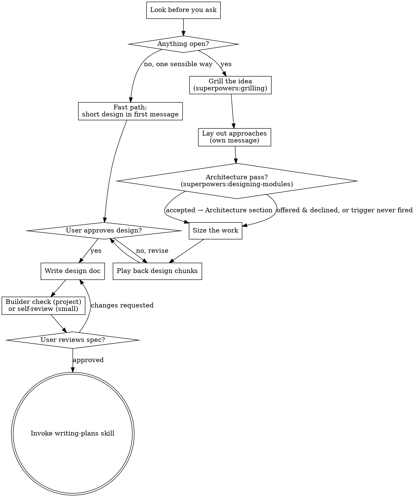

# Brainstorming Ideas Into Designs

You are very good at building. You build what you believe your human
partner wants, and that belief is usually thinner than it feels. This
skill finds out what they actually want, and why, before anything gets
built. When you understand the why, you make the hundred decisions they
never mention the way they would have made them.

Start from the project context, then refine the idea through
`superpowers:grilling`'s round-by-round interview. Once you understand
what you're building, lay out the approaches, write the design, and get
it approved.

<HARD-GATE>
Nothing gets built until your human partner approves a design: a short
one for a small change, the full written design for a project. Building
includes writing product code, scaffolding, installing dependencies,
creating projects, and invoking an implementation skill. Reading and
exploring are fine. This applies to EVERY task regardless of perceived
simplicity — a fast path shortens the design, it never removes the
approval.

The only thing built before approval is a `superpowers:prototype` probe
they said yes to. It stays throwaway; keeping what it produced is a new
request that comes back through this gate.

After the design is approved, the next step is the plan: invoke
`superpowers:writing-plans` and no other skill.
</HARD-GATE>

## Anti-Pattern: "This Is Too Simple To Need A Design"

Every task goes through the gate. A todo list, a single-function utility, a
config change — all of them. "Simple" tasks are where unexamined
assumptions cause the most wasted work. The design can be a few lines
(see Fast Path), but you MUST present it and get approval.

## Checklist

You MUST create a task for each of these items and complete them in order:

1. **Look before you ask** — read the project and everything they pointed at (see below)
2. **First message** — echo the request, report what bears on it, then ask *why* if they haven't said, or take the Fast Path when nothing is open (see Your First Message)
3. **Grill the idea** — invoke `superpowers:grilling` to interview down the decision tree (round 0 asks the why if still unknown; then frontier rounds with recommended answers, challenge against CONTEXT.md/ADRs, capture resolved terms/decisions inline). Resume here with the resolved design.
   - If a resolved design hinges on a question discussion can't settle, offer `superpowers:prototype` as a throwaway, subagent-isolated probe.
4. **Lay out the approaches** — 2-3 real alternatives with trade-offs and your recommendation, **in a message of their own**; they pick
5. **Architecture pass (optional)** — once the approach is chosen, if it introduces 2+ new modules or lands in an existing codebase with seams it has to fit, offer `superpowers:designing-modules` in its own message. If neither holds, never mention it. See the Architecture Pass section below and `references/architecture-pass.md`.
6. **Size the work** — say in plain words whether it's a small change or a project (they can override)
7. **Play back the design** — in chunks scaled to their complexity, ask what's wrong or missing after each
8. **Write design doc** — short or full, save to `docs/superpowers/specs/YYYY-MM-DD-<topic>-design.md` and commit
9. **Check the doc** — project: builder check subagent; small change: inline self-review (see below)
10. **User reviews written spec** — ask them to review the spec file before proceeding
11. **Transition to implementation** — invoke writing-plans skill to create implementation plan

## Process Flow

**The terminal state is invoking writing-plans.** Do NOT invoke frontend-design, mcp-builder, or any other implementation skill. The ONLY skill you invoke after brainstorming is writing-plans.

## Look Before You Ask

In an existing project, or when they've given you context (a spec, a plan,
a handoff, files they pointed at, earlier conversation), dig in before your
first message. Read what they referred to and the code it connects to, plus
CONTEXT.md and docs/adr/ if present, and keep reading until you can explain
how the relevant parts work today and what this change would touch. Never
ask what the project or their context already answers, or reopen what
they've already decided.

Assess scope here too: if the request describes multiple independent
subsystems (e.g., "build a platform with chat, file storage, billing, and
analytics"), flag it in your first message instead of refining details of
a project that needs decomposing first (see Decomposition).

## Your First Message

Move the work forward with one of these:

- **They've already said what they want** (a spec, a plan, a detailed
  request): aim for about 200 words. Echo the request back in your own
  words — what they want, who it's for, and why, as far as they've said —
  so they can see whether you've got its shape. Add what you found that
  bears on it: how the relevant parts work today and what the change would
  touch. If you found something they may not have considered that would
  change what they're asking for or how it's built (a constraint, a
  conflict with CONTEXT.md or an ADR, a cheaper path), say so plainly. End
  with one line inviting corrections. Then:
  - **Why unknown:** if they haven't said why they want it, even if you can
    guess, ask that: one open question in their own terms, with nothing to
    pick from. This is grilling's round 0.
  - **Something open:** if they have said why and the request leaves open
    something whose answer changes what gets built, hand over to grilling's
    frontier rounds.
  - **Nothing open:** take the Fast Path.
- **They haven't said what they want:** one open question, in their own
  terms, about the biggest thing their request leaves unsettled. Say what
  the answer would change about what you build.

Specs are often incomplete, so confirm before you build on one.

### Fast Path

When nothing is open and there's one sensible way, end your first message
with the short design itself: the approach, a line on why the others don't
fit, and the design in a few lines. Ask them to approve it. Their approval
covers the approach and the design: write the short design doc as approved
and go on to the plan.

If brainstorming started on its own (they didn't ask for it by name, by
invoking it, or by asking for a design discussion), you may end with a light
one-line offer to skip the questions: "Or if you'd rather skip the
questions, say so and I'll go with this." Taking that offer skips the
interview, **not the gate**: you still present the short design and get
their approval before anything is built. Never make that offer when they
asked for brainstorming.

## The Conversation

Ask a question only when the answer would change what gets built and
neither the request nor the project answers it. Otherwise state your call
and your reason as a proposal they can correct. **Process steps are always
your calls:** writing things up, where files go, looking further, how to
show something. Do them and say so. Use plain language, match their
vocabulary, never use process jargon, and never quote this skill at them.

**Get them describing.** Until you know why they want it, ask open
questions with no example answers attached — options steer, and their own
words carry intent yours can't. Once you know why, grilling's frontier
rounds take over, each question with its recommended answer.

**How it gets made.** Read from how they talk which choices about the how
(platform, language, libraries) they want to own. Someone who raises the
how or asks about trade-offs wants the options with your pick. Someone who
talks about outcomes is handing you the how: make those calls and state
each in a line. In existing work, build on what it already uses. Any
choice you make goes in the design as your call, never as something they
agreed to.

**Ground to cover** (territory for grilling's decision tree, not a script
to read out):

- what kind of thing this is, and what makes it special
- why now, and what success looks like to them
- goals, non-goals, and anti-goals (what would make this a failure even if it technically works)
- prior art: what they've seen elsewhere, loved or hated
- current state: what exists now, what they've tried
- the details they care about

**Lay out the approaches.** Once you understand what they want, and before
you write anything up, put the ways of building it in a message of their
own. Come up with several real alternatives and drop the weak ones,
including any that work against why they want it and any the existing work
or an ADR rules out. Sketch the two or three that remain concretely enough
to picture, with what each trades off. Lead with your recommendation and
say why, then ask which way they want to go; if they've handed you the how,
say you'll go with your pick. When there's genuinely one sensible way, say
so and explain why the others don't fit. YAGNI ruthlessly — remove
unnecessary features from every approach.

**Show, don't tell.** Whenever seeing would help more than reading, sketch
it in text: a few lines of what they'd see. Offer the visual companion
(below) when the look itself is theirs to decide.

**Probe instead of debating.** When a question can't be settled by
discussion, a quick throwaway build is often the cheapest way to learn.
Offer `superpowers:prototype`; it stays out of the repo and gets
discarded once it has answered the question. Bring what it taught you back
into the conversation.

## Size the Work

Once they've picked an approach, say how big the work is in plain words.
They can override it.

| Size | The design doc |
|------|----------------|
| A small change | short: what you already covered together, written down, a line or two per point |
| A project | the full written design (below) |

Short or full, the doc has an **Approaches** part: the two or three ways
you considered, what each trades off, which one they picked, and why.

If it grows mid-task, stop, say so, and step up a size.

### Decomposition

If the project is too large for a single spec, help them decompose it into
sub-projects: the independent pieces, how they relate, what order to build
them. Each sub-project gets its own spec → plan → implementation cycle.

For a genuinely multi-feature initiative, persist the decomposition as a
**PRD umbrella** at `docs/superpowers/prds/YYYY-MM-DD-<initiative>.md` —
problem statement, success criteria, and the feature list with build order.
Synthesize it from the grilling already done; do NOT re-interview. Then
brainstorm feature 1 through the normal flow; each feature's spec
references the PRD. Single-feature work skips the PRD (the spec's intent
section covers requirements).

## Play It Back

As soon as you understand one part well enough to describe it, play it
back — a few sentences if straightforward, up to 200-300 words if nuanced —
then continue with the next part. Only what they said goes in as theirs;
anything you filled in goes in as your proposal, with your reason. End each
chunk by asking what's wrong or missing.

If a chunk describes something they'll look at (a page, a screen, a
printout), put a text sketch next to it, or a mockup once the visual
companion is running.

**Design for isolation and clarity:**

- Break the system into smaller units that each have one clear purpose, communicate through well-defined interfaces, and can be understood and tested independently
- For each unit, you should be able to answer: what does it do, how do you use it, and what does it depend on?
- Can someone understand what a unit does without reading its internals? Can you change the internals without breaking consumers? If not, the boundaries need work.
- Smaller, well-bounded units are easier for you to work with — you reason better about code you can hold in context at once.

**Working in existing codebases:**

- Follow existing patterns.
- Where existing code has problems that affect the work (a file that's grown too large, unclear boundaries, tangled responsibilities), include targeted improvements as part of the design.
- Don't propose unrelated refactoring. Stay focused on what serves the current goal.

## The Written Design

Write a plain document a talented builder could plan from without going
back to your human partner. Cover:

- intent and the why
- goals, non-goals, anti-goals
- constraints (including relevant CONTEXT.md terms and ADRs)
- approaches (above)
- architecture (the designing-modules output, if the pass ran)
- the parts of the how they decided, as they decided them
- what's left to the builder

**Where it goes:** `docs/superpowers/specs/YYYY-MM-DD-<topic>-design.md`,
committed. Their preferences override this. Use
elements-of-style:writing-clearly-and-concisely if available.

### Builder Check (project)

Dispatch a fresh subagent with `builder-check-prompt.md` in this directory.
When you tell them you're writing it up, say a reviewer will read it first
and you may come back once with a few questions. Don't hand over the
document until the check is back. Sort what the builder asks into three
piles:

- **Answered already** by the conversation or the project: put the answer in the document.
- **Minor:** a sensible builder could settle it without changing what gets built. Settle it yourself and mark it in the document as your call.
- **Theirs:** only your human partner can answer it, and the answer changes what gets built.

Bring the "theirs" pile in one message, as a grilling-style round, most
important first. Update the document with their answers, then hand it over
with a short list of the calls you made so they can check those while
reading. That's the only round of questions the check produces. Without a
subagent tool, read the document as that builder yourself.

### Self-Review (small change)

Look at the short doc with fresh eyes: any placeholder or vague requirement,
any contradiction, anything that could be read two ways? Fix inline and
move on.

### User Review Gate

> "Spec written and committed to `<path>`. Please review it and let me know if you want to make any changes before we start writing out the implementation plan."

Wait for their response. If they request changes, make them and re-check.
Only proceed once they approve. Then invoke writing-plans — no other skill.

## Architecture Pass

`superpowers:designing-modules` works out module structure, interfaces and
seams. Offer it after the approach is chosen, only when the design adds
**2+ new modules** or lands in an **existing codebase with seams it has to
fit**, and only if you can name the specific coupling that fired the
trigger. Otherwise never mention it. **Before offering, read
`references/architecture-pass.md` in this directory** — it has the offer
wording, the don't-stack-offers rule, and what comes back.

## Red Flags

| Thought | Reality |
|---------|---------|
| "I'll offer a menu of what they might want" | Options steer. Until you know why, ask them to describe it. |
| "I'll fill in sensible defaults" | Good. Say them out loud. A default they never heard is one they couldn't reject. |
| "They said skip the questions, so I'll build" | Skipping the interview isn't skipping the gate. Short design, approval, then plan. |
| "I've answered their questions, so I'll write the doc" | Lay out the approaches first, in a message of their own. |
| "I should ask where to save this" | Process steps are your calls. Do it and say so. |
| "They said 'sounds good' to the idea" | Approval covers what you showed them. A design doc you haven't written isn't approved. |
| "The prototype works, I'll keep building on it" | Keeping it is a new request. Back through the gate. |

## Visual Companion

A browser tab for showing mockups, diagrams, and visual options. It's a
tool, not a mode: accepting it doesn't send every question to the browser.

**Offer it just-in-time,** never upfront — the first time one of these comes up:

- something they'll look at: a screen, a page, a printout
- a layout or arrangement
- a flow or a sequence of steps
- options that would look different from each other
- a structure that's easier to see than read: a diagram, a timeline, a map

The offer is its own message with nothing else in it:

> "This might be easier if I show you. Want me to open a browser tab with some mockups?"

If they accept, start the server with `--open` so their browser opens to the
first screen. If they decline, stay in text and don't offer again unless they
raise it.

**Per question, ask: would they understand this better by seeing it?**
Mockups, layouts, diagrams, and side-by-side designs go in the browser.
Requirements, scope, tradeoffs, and conceptual choices stay in text. A
question about a UI topic isn't automatically a visual question.

If they accept, read `visual-companion.md` in this directory before
starting the server.
